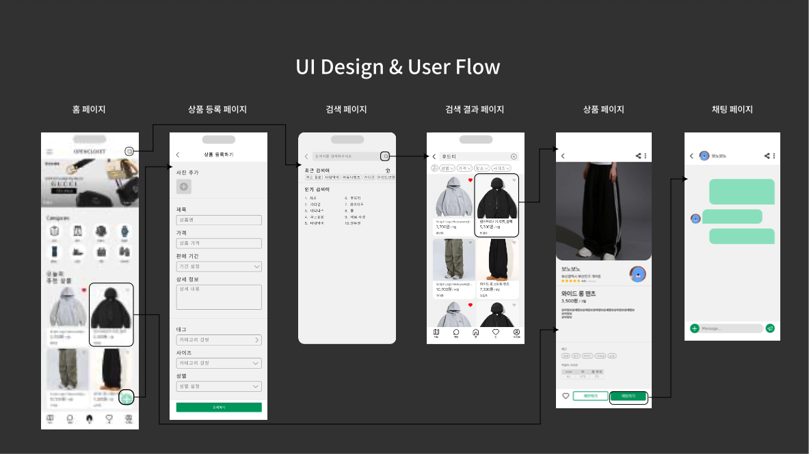
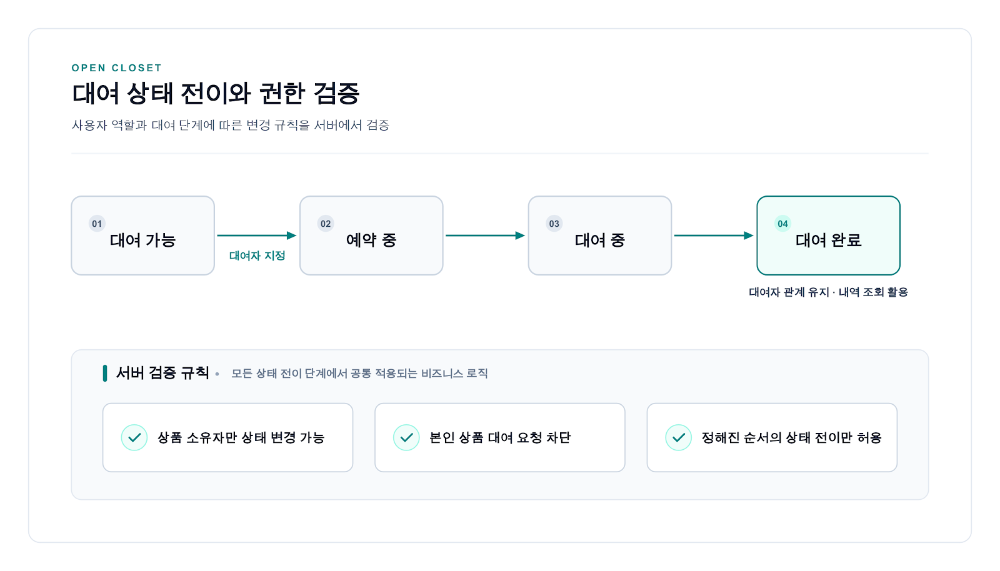
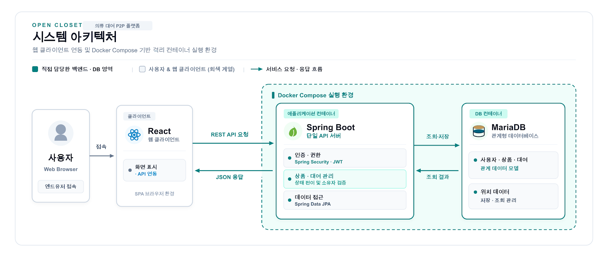
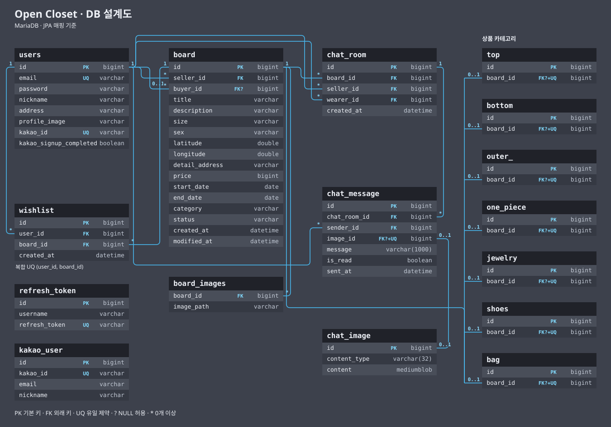

# Open Closet

**동네에서 옷을 찾고 빌리는 지역 기반 P2P 의류 대여 서비스의 백엔드입니다.**

**Java 17 · Spring Boot 3.4.4 · Spring Data JPA · MariaDB · Redis · Docker**

상품·대여 도메인 설계와 API 구현, 실시간 채팅, 상품 목록 조회 성능 개선, 배포 자동화를 담당했습니다.


## 서비스 소개

Open Closet은 사용하지 않는 옷을 이웃에게 빌려주고, 필요한 옷은 가까운 곳에서 빌려 입을 수 있도록 기획한 서비스입니다. 사용자는 자신의 주소를 기준으로 상품을 찾고, 거래 장소를 확인한 뒤 채팅으로 대여를 협의합니다. 제공자와 대여자는 각자의 대여 내역을 확인할 수 있습니다.

| 항목 | 내용 |
| --- | --- |
| 초기 프로젝트 | 2025.03.20 ~ 2025.06.24 |
| 팀 구성 | 4명 · 프론트엔드 2명, 백엔드 2명 |
| 현재 개발 | 팀원들과 출시를 준비하며 대여 관리, 상품 조회, 채팅·계정 기능 개발 및 개선 진행 |
| 출시 계획 | 2026년 12월 출시 예정 |

초기 프로젝트 이후에도 팀원들과 개발을 이어가고 있습니다. 현재는 2026년 12월 출시를 목표로 기능을 보완하고 있습니다.

[GitHub 기여자](https://github.com/DevFlow-DEU/OpenCloset_Back/graphs/contributors)

## 담당 역할

**김영진 · Backend Developer · [GitHub](https://github.com/oxoxoxoxox)**

아래는 본인 계정의 커밋에서 확인할 수 있는 백엔드 담당 범위입니다. 핵심 기능 절은 팀 서비스 전체를 설명하며, 회원·인증 등 모든 기능을 개인 기여로 포함하지 않습니다.

| 담당 영역 | 직접 구현·개선한 내용 | 근거 |
| --- | --- | --- |
| 상품·대여 모델과 API | 상품의 제공자(`seller`)·대여자(`buyer`) 관계, 상품 등록·수정, 등록 상품과 빌려준·빌린 내역의 조회 조건 분리 | [모델 변경](https://github.com/DevFlow-DEU/OpenCloset_Back/commit/dcdc3bdf25d5f25cd0eda6cf5aee65bc41223e0d) · [역할별 조회](https://github.com/DevFlow-DEU/OpenCloset_Back/commit/393df2ae2ec1a89205d0971b520d75ba68776e1d) |
| 권한·상태 검증 | 상품 소유자만 수정·상태 변경 허용, 예약 시 대여자 지정 및 자기 대여 차단, 허용된 순서의 상태 전이 검증 | [BoardService](src/main/java/DevFlow/OpenCloset_Back/Board/Service/BoardService.java) |
| 목록 조회 개선 | 커서 기반 페이지네이션, 이미지·찜 정보 일괄 조회, 커서 단위·HTTP 통합 테스트 | [개선 커밋](https://github.com/DevFlow-DEU/OpenCloset_Back/commit/6b79af59f71462c92515bbe91158a64acc9372fd) |
| 거래 채팅 | WebSocket/STOMP와 Redis Pub/Sub 메시지 전달, 참여자 검증, 채팅 이미지 업로드·조회 API | [Redis 연동](https://github.com/DevFlow-DEU/OpenCloset_Back/commit/54eb2d2ddf882bbbacf9ca2b9fcd6e8459568613) · [이미지 API](https://github.com/DevFlow-DEU/OpenCloset_Back/commit/8d6b8ee52811f90355a03ac98a49a97be37fff9b) |
| 실행·배포 구성 | Docker Compose 실행 환경, SSH 기반 서버 빌드·재배포 워크플로 구성·수정 | [배포 구성 커밋](https://github.com/DevFlow-DEU/OpenCloset_Back/commit/fbace62) · [현재 워크플로](.github/workflows/deploy.yml) |

현재는 기존 팀원들과 대여 관리, 상품 조회, 채팅과 계정 기능을 보완하고 있습니다. 프론트엔드 팀원들과 API 요청·응답 형식을 맞추며 연동합니다.

## 기획 배경


팀은 프로젝트를 기획하며 **의류의 낮은 활용도와 폐의류 문제**, **중고거래 과정의 신뢰 문제**, **다양한 옷을 경험하는 데 드는 비용**에 주목했습니다. 중고 의류 거래가 확산되는 흐름을 살펴보면서, 옷을 판매하는 것뿐 아니라 필요한 기간 동안 서로 빌려 쓰는 방식도 생각했습니다.

프로젝트 발표 당시에는 입지 않는 옷의 대여 의향과 의류 구매 대신 대여할 의향을 묻고 의견을 수집했습니다. 다양한 옷을 비용 부담을 줄여 경험하고 싶다는 의견과 함께, 빌려주고 다시 받는 과정이 번거롭거나 대여 중 오염이 걱정된다는 의견도 있었습니다.

이러한 문제를 바탕으로 **주소 기반 상품 탐색, 거래 장소 확인, 채팅을 통한 협의, 제공자·대여자별 내역 관리**를 중심으로 서비스를 설계했습니다. 사용자가 가까운 상품을 찾고 대여 과정에서 필요한 정보를 확인할 수 있도록 돕는 것이 목표입니다.

> 기획 배경과 사용자 의견은 프로젝트 당시 조사와 발표자료를 바탕으로 정리했습니다.

<details>
<summary>화면 설계와 사용자 흐름</summary>



</details>

## 핵심 기능

<details open>
<summary><strong>동네 상품 탐색과 찜</strong></summary>

- 로그인한 사용자의 프로필 주소와 제공자의 프로필 주소가 같은 상품을 기본 목록에 보여 줍니다.
- 상품 등록 시 이미지, 상세 주소, 거래 장소의 위도·경도를 저장합니다. 검색에서는 키워드와 카테고리, 가격 등의 조건으로 상품을 찾을 수 있습니다.
- 상품을 찜할 수 있으며, 기본 목록에서는 현재 페이지에 포함된 상품의 찜 여부를 함께 확인할 수 있습니다.

</details>

<details>
<summary><strong>대여 내역과 상태 관리</strong></summary>

상품에 제공자와 대여자를 연결하고, 빌려준 상품과 빌린 상품을 역할별로 조회할 수 있도록 구성했습니다. 상태 변경은 상품 소유자만 요청할 수 있으며, 예약 단계에서 대여자를 지정합니다. 대여가 끝난 뒤에도 대여자 관계를 유지해 내역 조회에 활용합니다.



</details>

<details>
<summary><strong>거래 채팅</strong></summary>

상품을 기준으로 채팅방을 생성하고 사용자 간 메시지와 이미지를 주고받을 수 있도록 구현했습니다.

- WebSocket/STOMP 메시지 송수신과 채팅방 참여자 접근 검증
- 대화 내역 조회, 이미지 업로드·조회
- 메시지 저장 트랜잭션 커밋 후 Redis의 `chat:room:{roomId}` 채널로 메시지 발행

애플리케이션의 Redis 리스너가 메시지를 받아 STOMP의 `/topic/chat/{roomId}` 구독자에게 전달합니다. 채팅 이미지는 MariaDB에 바이너리 데이터로 저장하고, 참여자를 검증한 HTTP API로 제공합니다.

</details>

<details>
<summary><strong>회원과 인증</strong></summary>

- **인증** — 회원가입, 일반 로그인과 카카오 로그인, JWT 요청 인증과 토큰 갱신
- **인가** — 상품 수정·대여 상태 변경 시 소유자 확인, 채팅방 접근 시 참여자 확인
- **계정 관리** — 프로필 조회·수정, 비밀번호 변경과 탈퇴

</details>

## 시스템 아키텍처



그림은 웹 화면에서 REST API를 호출하고 MariaDB에서 데이터를 조회하는 기본 흐름입니다. 현재 백엔드는 채팅의 실시간 전달에 Redis Pub/Sub를 사용하며, 로컬 실행 환경은 Spring Boot, MariaDB, Redis를 Docker Compose로 실행합니다.

## DB 설계



- **상품 등록** — `board.seller_id`로 등록한 회원(`users`)을 연결합니다. 한 회원이 여러 상품을 등록할 수 있습니다.
- **대여 내역** — 예약 시 `board.buyer_id`에 대여자를 지정하고, 대여 완료 후에도 관계를 유지해 빌린 내역을 조회합니다.
- **채팅 내역** — `chat_message.chat_room_id`로 메시지가 속한 채팅방을 연결합니다. 한 채팅방에 여러 메시지가 쌓입니다.
- **찜 목록** — `wishlist`가 회원과 상품을 연결합니다. `(user_id, board_id)` 복합 유일 제약으로 중복 등록을 막습니다.

[DB 설계 상세 설명](docs/database-erd.md)

## 상품 목록 조회 개선

### 기존 조회 구조의 문제

기존 `GET /board/All`은 첫 화면에도 주소가 같은 상품을 모두 반환했습니다. 상품마다 이미지를 추가 조회하고 로그인 사용자의 전체 찜 목록을 읽어, 상품 수가 늘어날수록 응답량과 SQL 실행 횟수가 증가했습니다.

### 개선 내용

| 변경 | 구현 |
| --- | --- |
| 커서 기반 페이지네이션 | `modifiedAt DESC, id DESC` 정렬과 수정 시각·ID 커서로 다음 상품부터 조회 |
| 페이지 크기 제한 | 기본 20개 반환, 한 행을 더 조회해 `hasNext` 판단 |
| 연관 데이터 일괄 조회 | 판매자·구매자는 목록 쿼리에서 함께 조회하고, 이미지·찜 여부는 현재 페이지의 상품 ID로 각각 일괄 조회 |
| 테스트 | 잘못된 커서, 같은 수정 시각의 페이지 경계, 다음·마지막 페이지를 단위·HTTP 통합 테스트로 검증 |

응답은 `items`, `nextCursor`, `hasNext`로 구성합니다.

목록 쿼리에서는 단일 연관관계인 제공자·대여자만 함께 조회해 상품 수를 기준으로 조회 범위를 제한합니다. 여러 이미지가 연결된 컬렉션은 페이지의 상품 ID를 확정한 뒤 별도로 일괄 조회해, 이미지 행 수가 페이지 크기에 영향을 주지 않도록 했습니다. 수정 시각이 같은 상품은 ID를 추가 정렬 기준으로 사용해 페이지 경계를 구분합니다.

### 로컬 측정 결과

| 지표 | 변경 전 | 변경 후 |
| --- | ---: | ---: |
| 첫 화면 반환 상품 | 4,000개 | 20개 |
| 첫 화면 p95 응답 시간 | 1,784.6ms | 31.6ms |
| 요청당 SQL 실행 횟수 | 4,088회 | 5회 |

수치는 **첫 화면에 필요한 20개만 반환하는 페이지네이션과 연관 데이터 일괄 조회를 함께 적용한 결과**입니다. 변경 전후 반환량이 다르므로 동일한 작업량의 쿼리 성능 비교가 아니며, 각 변경의 효과를 개별적으로 분리해 측정한 결과도 아닙니다. 운영 환경의 동시 접속 처리량을 나타내지 않습니다.

- **환경·데이터** — 로컬 MariaDB, 전체 상품 5,000개 중 주소 일치 상품 4,000개
- **요청** — 워밍업 5회 후 각 조건에서 30회 순차 요청
- **SQL 집계** — 인증과 응답 구성에 필요한 쿼리 포함

[변경 전 측정 원본](docs/performance/board-pagination-before.json) · [변경 후 측정 원본](docs/performance/board-pagination-after.json)에는 요청별 응답 시간과 SQL 실행 횟수가 기록되어 있습니다. 2026년 11월 11일 측정 기록이며, 원본의 요청별 값으로 p95와 SQL 횟수를 대조했습니다.

<details>
<summary>커서 경계와 테스트</summary>

커서 단위 테스트는 잘못된 형식과 수정 시각의 정밀도를 검증합니다. HTTP 통합 테스트는 같은 수정 시각을 가진 상품이 페이지 경계에 놓인 경우와 다음 페이지·마지막 페이지 처리, 잘못된 커서 요청을 확인합니다. 여러 페이지를 조회하는 사이에 상품의 수정 시각이 바뀌면 순서가 달라질 수 있습니다. 첫 페이지부터 다시 조회하면 현재 순서를 확인할 수 있습니다.

[목록 개선 커밋](https://github.com/DevFlow-DEU/OpenCloset_Back/commit/6b79af59f71462c92515bbe91158a64acc9372fd) · [커서 조회 구현](src/main/java/DevFlow/OpenCloset_Back/Board/Repository/BoardListRepository.java) · [커서 단위 테스트](src/test/java/DevFlow/OpenCloset_Back/Board/BoardListCursorTest.java) · [HTTP 통합 테스트](src/test/java/DevFlow/OpenCloset_Back/Board/BoardPaginationIntegrationTest.java)

</details>

## 대표 API

Controller의 실제 매핑을 기준으로 정리했습니다. `/board/All`의 대소문자도 구현과 같습니다. 상품·프로필·채팅 이미지 업로드는 `multipart/form-data`를 사용합니다.

| 영역 | Method | 경로 | 기능 |
| --- | --- | --- | --- |
| 상품 | POST | `/board/create` | 상품과 이미지 등록 |
| 상품 | GET | `/board/All` | 내 동네 상품의 커서 기반 목록 조회 |
| 대여 | PATCH | `/board/{id}/status` | 소유자의 대여 상태 변경 |
| 대여 | GET | `/board/my/owner` · `/board/my/renter` | 빌려준 내역 · 빌린 내역 조회 |
| 채팅 | POST | `/chat/room` | 상품 기준 채팅방 생성·조회 |

<details>
<summary>추가 API 및 Controller 코드 보기</summary>

| 영역 | Method | 경로 | 기능 |
| --- | --- | --- | --- |
| 상품 | GET | `/board/{id}` | 상품 상세 조회 |
| 상품 | PUT | `/board/{id}` | 소유자의 상품 수정 |
| 인증 | POST | `/auth/register` · `/auth/login` · `/auth/refresh` | 회원가입 · 로그인 · 토큰 갱신 |
| 프로필 | GET | `/mypage/profile` | 내 프로필 조회 |
| 프로필 | POST | `/mypage/edit` | 프로필과 이미지 수정 |
| 채팅 | GET | `/chat/rooms` | 참여 중인 채팅방 목록 조회 |
| 채팅 | GET | `/chat/room/{roomId}/messages` | 대화 내역 조회 |
| 채팅 이미지 | POST | `/chat/room/{roomId}/messages/image` | 이미지 메시지 업로드 |
| 채팅 이미지 | GET | `/chat/room/{roomId}/messages/{messageId}/image` | 참여자 권한 확인 후 이미지 조회 |

실시간 텍스트 전송은 HTTP API와 구분됩니다. STOMP의 전송 경로는 `/app/chat/send`, 구독 경로는 `/topic/chat/{roomId}`입니다. 상품·프로필 이미지는 파일로 저장하고 `/uploads/**`의 정적 리소스로 제공하며, 채팅 이미지는 위의 참여자 전용 API로 제공합니다.

매핑 근거: [상품 Controller](src/main/java/DevFlow/OpenCloset_Back/Board/Controller/BoardController.java) · [채팅 Controller](src/main/java/DevFlow/OpenCloset_Back/Chat/Controller/ChatController.java) · [회원가입](src/main/java/DevFlow/OpenCloset_Back/User/User_Controller/RegistrationController.java) · [로그인](src/main/java/DevFlow/OpenCloset_Back/Login/Login_Controller/LoginController.java) · [토큰 갱신](src/main/java/DevFlow/OpenCloset_Back/Login/Login_Controller/TokenRefreshController.java) · [프로필](src/main/java/DevFlow/OpenCloset_Back/User/User_Controller/MyPageController.java)

</details>

## 기술 스택

| 영역 | 기술 |
| --- | --- |
| API | Java 17, Spring Boot 3.4.4, Spring Security, JWT |
| 데이터 | Spring Data JPA, Hibernate, MariaDB |
| 채팅 | WebSocket, STOMP, Redis Pub/Sub |
| 빌드·실행·배포 | Gradle Wrapper, Docker Compose, GitHub Actions |
| API 문서 | Springdoc OpenAPI, Swagger UI |

## 로컬 실행

Docker와 Docker Compose가 필요합니다. 저장소 루트에서 처음 실행할 때 [환경 변수 예제](.env.example)를 `.env`로 복사합니다. 기존 `.env`가 있으면 현재 설정을 사용합니다.

```powershell
if (-not (Test-Path .env)) { Copy-Item .env.example .env }
```

| 환경 변수 | 용도 |
| --- | --- |
| `DB_USERNAME`, `DB_PASSWORD`, `DB_ROOT_PASSWORD` | 로컬 MariaDB 계정과 비밀번호. 처음 시작하기 전에 설정합니다. |
| `APP_PORT`, `DB_PORT`, `REDIS_PORT` | 호스트에서 접속할 포트. 기본값은 각각 `8080`, `13306`, `6379`입니다. |
| `EMAIL_PASSWORD`, `KAKAO_CLIENT_ID`, `KAKAO_CLIENT_SECRET`, `KAKAO_REDIRECT_URI` | 메일 발송과 카카오 로그인에 필요한 설정. 해당 기능을 사용할 때 개발용 값을 입력합니다. |

Compose 안에서는 애플리케이션이 MariaDB의 `db:3306`과 Redis의 `redis:6379`에 접속합니다. 예제 파일의 `DB_URL`과 `REDIS_HOST`는 IDE에서 직접 실행할 때 쓰는 값입니다.

```powershell
docker compose -f docker-compose.local.yml up -d --build
```

애플리케이션 시작 후 [Swagger UI](http://localhost:8080/swagger-ui/index.html)와 [OpenAPI JSON](http://localhost:8080/v3/api-docs)에서 API를 확인할 수 있습니다. `APP_PORT`를 변경했다면 접속 주소의 포트도 바꿉니다.

새 DB 볼륨에서는 MariaDB가 `OpenCloset` 데이터베이스와 계정을 만들고, 애플리케이션이 시작되면 Hibernate의 `ddl-auto=update` 설정에 따라 테이블을 생성하거나 갱신합니다. 상품 목록을 확인하려면 Swagger에서 회원을 등록하고 프로필 주소를 설정한 뒤 상품을 등록합니다.

실행을 종료하려면 아래 명령을 사용합니다. DB, Redis, 업로드 파일은 볼륨에 남습니다.

```powershell
docker compose -f docker-compose.local.yml down
```

로컬 데이터를 처음부터 다시 만들 때만 `docker compose -f docker-compose.local.yml down --volumes`를 실행한 뒤 다시 시작합니다. **이 명령은 MariaDB, Redis, 업로드 파일의 로컬 데이터를 모두 삭제합니다.**

## 배포 구성

[로컬 Compose](docker-compose.local.yml)는 애플리케이션, MariaDB, Redis를 각각 컨테이너로 실행하고 DB·Redis 상태를 확인한 뒤 애플리케이션을 시작합니다.

[GitHub Actions 워크플로](.github/workflows/deploy.yml)의 현재 배포 절차는 다음과 같습니다.

1. `main` 또는 `jin_part` 브랜치에 push하면 실행됩니다.
2. SSH로 서버에 접속하고 `/home/ubuntu/OpenCloset_Back`에서 푸시된 브랜치를 fetch·checkout·pull합니다.
3. 서버에서 `./gradlew clean build -x test`를 실행합니다. **배포 빌드에서 테스트는 실행하지 않습니다.**
4. `sudo docker compose up -d --build --force-recreate`로 이미지를 빌드하고 컨테이너를 재생성한 뒤 사용하지 않는 이미지를 정리합니다.

[서버 Compose](docker-compose.yml)는 애플리케이션, MariaDB, Redis를 실행합니다. Redis의 healthcheck를 기다리지만 DB는 컨테이너 시작 여부만 확인합니다.

**배포 확인:** [Actions 실행 이력](https://github.com/DevFlow-DEU/OpenCloset_Back/actions)으로 명령의 성공 여부를 확인하고, 서버에서 `sudo docker compose ps`, `sudo docker compose logs --tail=100 app` 및 실제 API 응답을 함께 확인해야 합니다. 현재 워크플로의 성공 메시지는 재배포 명령의 완료를 뜻하며, HTTP 응답이나 서비스 정상 동작을 자동 검증하지 않습니다.

**향후 개선:** 배포 전 테스트 실행과 재배포 후 HTTP 확인 단계를 추가하는 것이 필요합니다. 현재 구현된 자동화와 구분해 개선 과제로 남깁니다.

## 참고 자료

- [Open Closet Notion 프로젝트 정리](https://app.notion.com/p/2eed6df1c80d81af8663c920713b386e)
- [README 구성 참고 · All-Life](https://github.com/ByeolNabi/All-Life)
