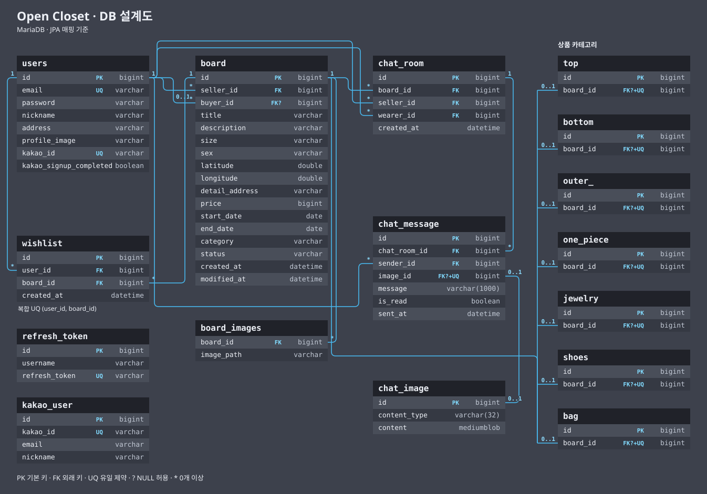
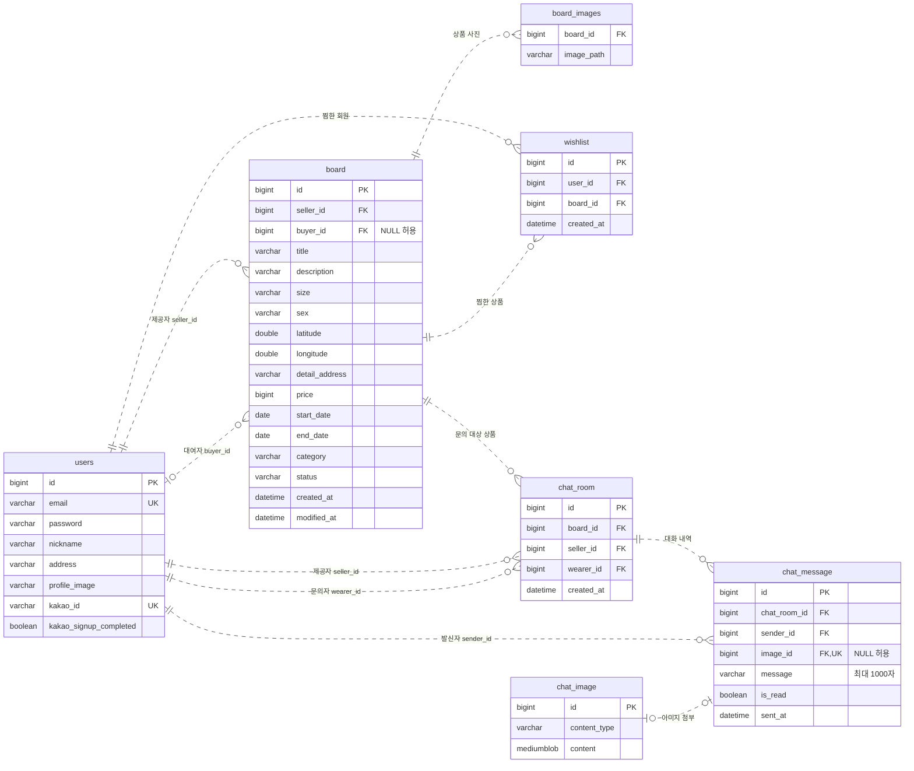
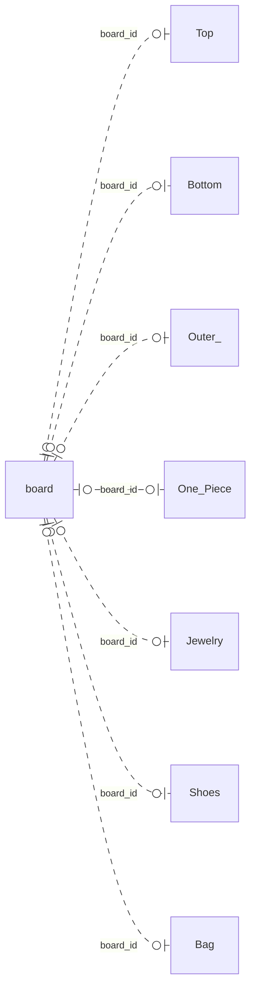
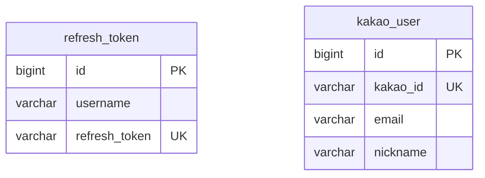

# Open Closet DB 설계도 (ERD)

백엔드 커밋 `8d6b8ee`의 JPA 매핑을 기준으로 정리했습니다. 테이블명과 자료형은 MariaDB 매핑을 기준으로 표기했으며, null 허용 여부와 제약은 코드에서 확인한 내용을 설명에 덧붙였습니다. 운영 DB의 실제 DDL은 확인하지 않았습니다.

## 회원 · 상품 · 대여 · 채팅

- **대여 정보**는 `board`에 저장합니다. 상품 등록 때 제공자(`seller_id`)를 연결하고 예약 단계에서 대여자(`buyer_id`)를 지정합니다. `buyer_id`는 대여 완료 후에도 유지되며 빌린 내역 조회에 쓰입니다. `chat_room.wearer_id`는 대여를 문의한 사용자를 가리킵니다.
- **찜**은 회원과 상품의 다대다 관계를 `wishlist`로 연결합니다. `(user_id, board_id)`에 복합 유일 제약을 둡니다.
- **이미지**는 상품과 채팅에서 각각 다르게 관리합니다. 상품은 `board_images`에 파일 경로를 저장합니다. 채팅은 `chat_image`에 바이너리를 저장하고 메시지가 선택적으로 참조합니다.

## 카테고리 매핑

아래 카테고리는 Java 엔티티명으로 표기했습니다. 각 엔티티는 자체 `id`와 `board`를 참조하는 `board_id`를 가집니다. `board_id`는 각 테이블 안에서 유일하며 JPA 매핑상 null을 허용합니다. 상품의 `category`에 맞는 매핑을 저장하고 카테고리 변경 시 기존 매핑을 정리하는 일은 `BoardService`가 담당합니다.

## 인증 관련 테이블

`refresh_token.username`에는 로그인 서비스가 사용자 이메일을 넣습니다. 현재 카카오 로그인 서비스는 `users.kakao_id`로 회원을 찾습니다. `kakao_user`는 엔티티로 선언되어 있으며, 두 인증 테이블에 `users`를 참조하는 FK 매핑은 없습니다.

Redis Pub/Sub는 채팅의 실시간 전달에 사용합니다. 채팅 메시지와 이미지의 영속 데이터는 MariaDB에 남습니다.

코드 근거는 [상품 엔티티](../src/main/java/DevFlow/OpenCloset_Back/Board/entity/Board.java), [상품 서비스](../src/main/java/DevFlow/OpenCloset_Back/Board/Service/BoardService.java), [찜 엔티티](../src/main/java/DevFlow/OpenCloset_Back/Wishlist/Entity/Wishlist.java), [채팅방 엔티티](../src/main/java/DevFlow/OpenCloset_Back/Chat/ChatRoom/Entity/ChatRoom.java), [채팅 메시지 엔티티](../src/main/java/DevFlow/OpenCloset_Back/Chat/ChatMessage/Entity/ChatMessage.java), [인증 코드](../src/main/java/DevFlow/OpenCloset_Back/Login)에서 확인할 수 있습니다.
